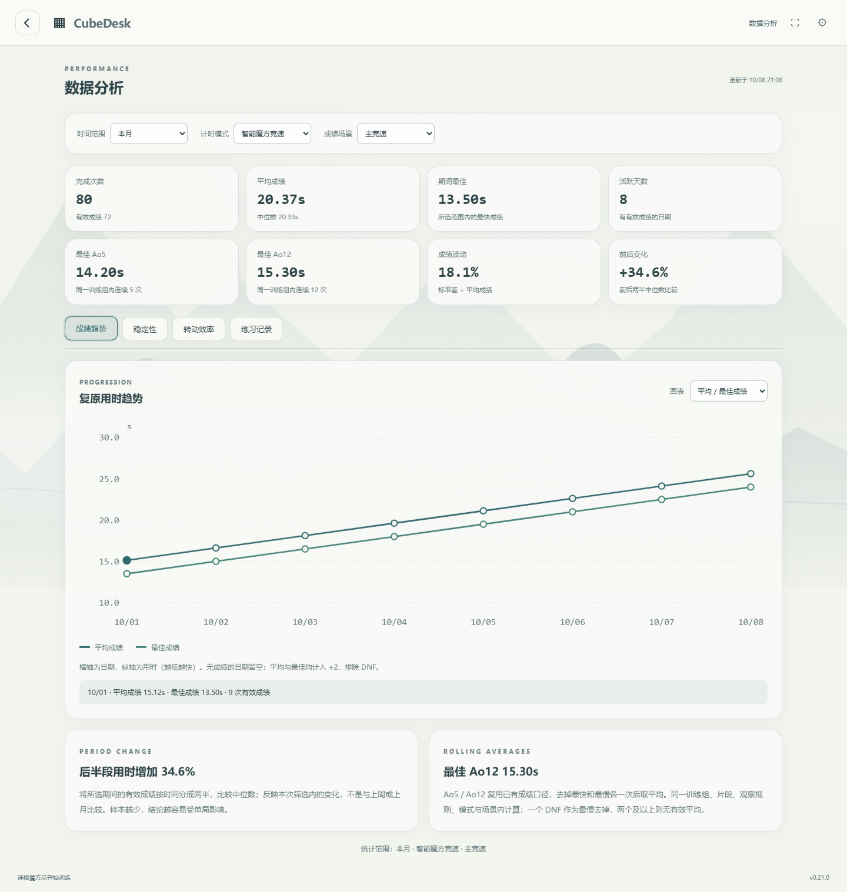
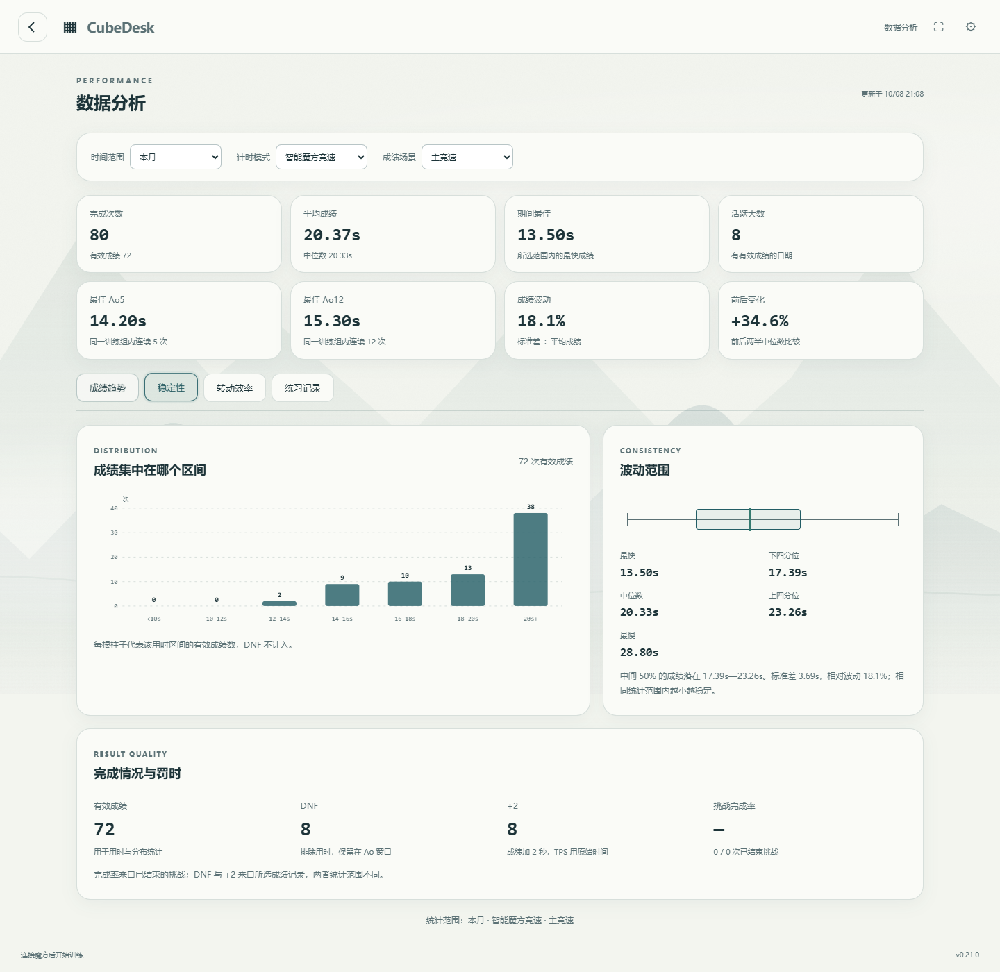

# CubeDesk

CubeDesk 是一款 Windows / Android 智能魔方训练应用，提供竞速计时、普通魔方计时、CFOP训练、本地成绩分析与可定制成就。核心训练与数据在本地运行，支持离线使用；安卓版支持横竖屏。

## 最新正式版 · 1.0.3 · 2026-10-23

|平台|版本|下载|
|---|---|---|
|Android|1.0.3，versionCode48|[下载安卓版](https://github.com/Jay6668/CubeDesk-Releases/releases/download/v1.0.3/CubeDesk-Android-1.0.3.apk)|
|Windows|1.0.3|[下载电脑版](https://github.com/Jay6668/CubeDesk-Releases/releases/download/v1.0.3/CubeDesk-Windows-1.0.3.exe)|

[本次发行说明](https://github.com/Jay6668/CubeDesk-Releases/releases/tag/v1.0.3)

### 国内下载

[夸克分享](https://pan.quark.cn/s/88e2650d3fa8)，提取码 **4bdt**，由作者另行维护；请按文件名确认对应平台和版本。

### 本次更新

- 成绩卡新增极简、竞速、仪表、画卷、杂志、趣味六种独立样式，均随五套应用主题适配配色与背景。
- 设置中的成绩卡选项压缩为一行，下拉选择后点击“预览”弹出浅色示例，不占用设置页大面积空间。
- 修复猫主题画卷/趣味卡片的猫咪裁切、极简款手机竖屏越界，以及关闭按钮遮住日期或保存状态。
- 优化墨夜成绩卡的冷墨配色和原创山水背景，保持真实成绩卡与应用主题一致。
- 补齐长用时、+2、DNF和旋转后的数字适配，保留原成绩、分析入口及继续练习操作。

### 安装与更新

- Android支持8.0及以上（arm64-v8a / x86_64），仅需智能魔方蓝牙连接，不含开发板控制功能。请同包名、同签名**覆盖安装**，不要先卸载或清除数据；建议更新前从设置导出备份。
- Windows需10/11 64位与Edge WebView2 Runtime。关闭旧版后运行新版EXE，沿用原数据目录；建议更新前导出备份。
- 设置中的更新检查优先读取[Gitee国内版本源](https://gitee.com/jiuzhijin/cubedesk-releases)，GitHub为备用。检查可关闭，失败不影响离线使用；下载和安装由用户确认。
- 新公式深度改进、独立下载网站与新型号实物验证留待后续，不把协议接入描述成所有魔方都已实测。

## 已接入的智能三阶协议

|品牌 / 系列|协议范围|
|---|---|
|魔域 MoYu|MoYu32（含威龙 V10 AI）、MHC v1|
|GAN|Gen1 / Gen2 / Gen3 / Gen4（含356i、GAN12ui、FreePlay、GANic、i4等对应系列）|
|奇艺 / X-Man|奇艺智能三阶、Tornado V4对应协议|
|GiiKER / Mi|GiiKER、Mi Smart Cube对应协议|
|GoCube / Rubik's|GoCube、Rubik's Connected|

其他型号建议尝试扫描，设备按实际GATT服务识别；同品牌不同固件不保证通用，部分型号需要MAC。电量、姿态和历史能力取决于设备。本轮没有新增型号的实机验收，不将协议接入描述为全型号实测。当前不支持二阶设备。

设备中心提供独立陀螺仪设置。开启姿态跟随且收到有效姿态时，复原同步提示摆成白上绿前再校准；关闭跟随或无姿态能力时保留普通同步流程。

协议实现参考MIT许可的[gan-web-bluetooth](https://github.com/afedotov/gan-web-bluetooth)和[smartcube-web-bluetooth](https://github.com/poliva/smartcube-web-bluetooth)，许可随应用保留。

## 数据分析

单次分析可在设置中切换CFOP或Roux桥式；分段TPS保留一位小数，建议结合自己的历史记录，不把F2L占时最长直接视为短板。

成绩趋势、稳定性、转动效率、练习记录四个视角，配合折线图、数量柱状图、四分位范围、散点图、练习日历和分页记录；支持今天、近 30 天、近 3 个月等时间范围。

以下截图使用隔离的示例数据，不包含真实用户成绩。

## 下载校验与源码

发行说明提供各包SHA-256，仓库保留`SHA256SUMS.txt`，可核对文件完整性。此公开仓库只提供下载、说明、版本信息和示例截图；源码保存在独立私有仓库，下载包不包含个人成绩或配置。
